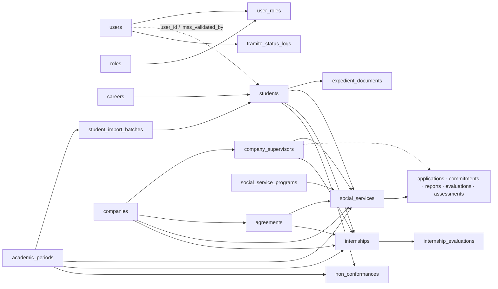
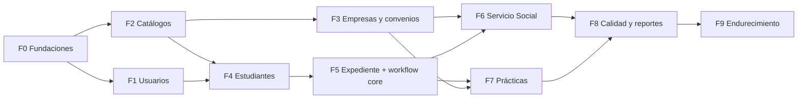

# Plan 02: Roadmap backend a partir del esquema relacional

> **Estado:** Borrador v0.1 · 2026-10-20. Fuente: [`schema.sql`](../../database/design/schema.sql) y [`design/README.md`](../../database/design/README.md). Contratos: [`api-conventions.spec.md`](../specs/api-conventions.spec.md) y specs por módulo.

## 1. Análisis del esquema

### 1.1 Entidades por capa

| Capa | Tablas | Rol en el sistema |
| --- | --- | --- |
| Identidad | `users`, `roles`, `user_roles` | Login local, 5 roles, N:M. Ya mapeadas en Auth |
| Catálogos | `careers`, `academic_periods`, `social_service_programs`, `institutional_authorities`, `document_series` | Datos de referencia sin dependencias de negocio |
| Padrón externo | `companies`, `company_supervisors`, `agreements` | Receptores de alumnos; supervisores no son usuarios |
| Padrón estudiantil | `students`, `student_import_batches` | Expediente central; 1:1 opcional con `users` |
| Expediente | `expedient_documents` | Repositorio polimórfico (`tramite_type` + `tramite_id` sin FK) |
| Servicio Social | `social_services` (maestro) + `applications` 1:1, `commitments` 1:1, `bi_monthly_reports` 1:N (máx. 3), `evaluations` 1:N, `activity_assessments` 1:1 | Trámite de 480 h, Anexos XVIII–XXV |
| Prácticas | `internships` (maestro) + `internship_evaluations` 1:1 | Trámite de 100/200–480 h, Anexo XVII |
| Calidad | `tramite_status_logs`, `non_conformances` | Bitácora append-only y PNC ISO 9001 (polimórficos) |

### 1.2 Grafo de dependencias (FK reales)



Sin ciclos. Las tablas polimórficas (`expedient_documents.tramite_id`, `tramite_status_logs`, `non_conformances.tramite_id`) usan llave lógica: no generan ciclos de FK, pero obligan a validar existencia y pertenencia en el service.

### 1.3 Restricciones relacionales relevantes

- `ON DELETE RESTRICT` en casi todas las FK de negocio. Como la API solo hace borrado lógico, RESTRICT no se dispara; la API debe **replicar la regla** y responder `409 *.in_use` si hay dependientes vivos.
- `ON DELETE CASCADE` solo en `user_roles → users`. `SET NULL` en FKs opcionales (`students.user_id`, `agreement_id`, `evaluator_supervisor_id`, revisores).
- UNIQUE 1:1: `students.user_id`, `ss_applications.social_service_id`, `ss_commitments.social_service_id`, `ss_activity_assessments.social_service_id`, `internship_evaluations.internship_id`.
- UNIQUE compuestos: `(social_service_id, report_number)`, `(social_service_id, evaluator_type, bimonthly_period)`, `(document_type, current_year)`, `(user_id, role_id)`.
- Todas las UNIQUE son **totales**, no parciales: un registro borrado lógicamente sigue bloqueando su clave (ver D5).
- Auditoría: `created_by/updated_by/deleted_by` sin FK (intencional). `updated_at` sin trigger: lo debe fijar la app.

### 1.4 Reglas de negocio

**Garantizadas por BD (checks):** horas SS ≥ 480; horas PP 100–480; créditos PP = 2; `report_number ∈ {1,2,3}`; `accumulated_hours ≥ reported_hours`; rangos de fechas inicio ≤ fin; semestre 1–15; avance 0–100; escalas cualitativas y numéricas 0–4; enums de estado, sector, tamaño, tipo de convenio, categorías.

**Deducidas, a garantizar en services:**

| # | Regla | Módulo |
| --- | --- | --- |
| R1 | Supervisor y convenio del trámite pertenecen a la misma `company_id` | SS, PP |
| R2 | Convenio activo, vigente en `start_date` y de tipo compatible con el trámite | SS, PP |
| R3 | `modality=internal` ⇔ `companies.is_tecnm_internal=true` | SS |
| R4 | Duración SS: mínimo 6 meses, máximo 2 años | SS |
| R5 | Máximo un trámite no terminal por alumno y tipo; uno `released` impide otro | SS, PP |
| R6 | Elegibilidad SS ≥ 70 % de créditos e inscripción vigente; PP pendiente (D7) | Students |
| R7 | IMSS vigente requerido para pasar a `active` | SS, PP |
| R8 | Reportes secuenciales: *n* exige *n−1* aprobado; acumulado calculado por backend | SS |
| R9 | `social_services.accumulated_hours` es desnormalizado: se sincroniza al aprobar reporte | SS |
| R10 | `semester_enrolled` es snapshot inmutable de `students.current_semester` | SS, PP |
| R11 | Promedio, nivel y competencia de Anexo XVII los calcula backend | PP |
| R12 | Folios por `document_series`, incremento atómico en la transacción de liberación | Core |
| R13 | Toda transición de estado escribe `tramite_status_logs` en la misma transacción | Core |
| R14 | `non_compliant` crea PNC automáticamente | SS, PP, Calidad |
| R15 | Documento nuevo sustituye al previo `pending/rejected` del mismo código (`superseded`) | Expediente |
| R16 | Un solo periodo activo; una sola autoridad activa por `role_key` | Catálogos |
| R17 | `curriculum_progress_percentage` derivado de créditos / créditos de carrera | Students |

### 1.5 Discrepancias detectadas (DDL vs README)

| # | Hallazgo | Impacto | Propuesta |
| --- | --- | --- | --- |
| X1 | `ck_internships__required_hours`: DDL `BETWEEN 100 AND 480`; ADR-11 dice 200–480 | Validación PP | Decidir (D6) y alinear ambos |
| X2 | README cita `fk_ss_applications__reviewer` y `fk_ss_bi_monthly_reports__approver`; no existen en DDL | `reviewed_by` / `approved_by` sin integridad | Agregar FKs a `users` en DDL |
| X3 | ER del README: `academic_periods ||--o{ students`; no hay FK directa | Documental | Corregir diagrama |
| X4 | `residency` admitido en `tramite_status_logs` y `non_conformances`; no existe tabla ni lo admite `expedient_documents` | API debe rechazarlo | Mantener reservado; API → `400` |
| X5 | UNIQUE totales + soft delete | Recrear código borrado falla con `409` | D5 |
| X6 | `student_import_batches.status` default `'completed'` | Lote nace "completado" | Cambiar default a `'pending'` |
| X7 | `institutional_authorities.role_key` sin CHECK ni unicidad de activo | Firmantes duplicados | CHECK + índice único parcial `WHERE is_active AND deleted_at IS NULL` |
| X8 | `academic_periods.is_active` sin unicidad | Varios periodos vigentes | Índice único parcial `ON (is_active) WHERE is_active AND deleted_at IS NULL` |
| X9 | `document_series.document_type` no incluye folio PNC | `incident_code` sin secuencia atómica | D9 |
| X10 | `department_head` sin relación con carrera/departamento | Alcance de lectura indefinido | Lectura global en v1; revisar después |
| X11 | `TecNMDbContext` nombra PKs `pk_*`; BD real usa `*_pkey` | Solo afecta si se usan migraciones EF | Quitar `HasName` o ignorar (D1) |
| X12 | `.env.example` apunta a `tecnm_template:5433`; `backend/AGENTS.md` a `:5432` | Configuración local confusa | D13 |

### 1.6 Decisiones a confirmar

| ID | Decisión | Recomendación |
| --- | --- | --- |
| D1 | Fuente del esquema | `schema.sql` manda. EF Core solo mapea; **sin** migraciones EF |
| D2 | Mapeo `snake_case` | Paquete `EFCore.NamingConventions` (`UseSnakeCaseNamingConvention`) en vez de ~500 `HasColumnName` manuales |
| D3 | Formato de error | ProblemDetails + `code` para módulos nuevos; Auth intacto |
| D4 | Pruebas | Proyecto `tests/TecNM.Api.Tests` (fuera de `backend/`; el SDK Web compilaría los `.cs` de subcarpetas). xUnit + `Microsoft.AspNetCore.Mvc.Testing` + `Testcontainers.PostgreSql` (aplica `schema.sql` + seeds) |
| D5 | Soft delete vs UNIQUE | Cambiar UNIQUE de catálogos a índices únicos parciales `WHERE deleted_at IS NULL`. Alternativa sin DDL: restaurar en vez de recrear |
| D6 | Horas mínimas PP | Confirmar 100 o 200 con lineamiento vigente |
| D7 | Elegibilidad PP | Confirmar umbral de créditos/semestre |
| D8 | Generación de PDFs | Frontend (jsPDF ya en stack) con `print-data`; backend dueño de folios |
| D9 | Folio PNC | Agregar `'non_conformance'` al CHECK de `document_series` y reutilizar generador |
| D10 | Universo 911.10 | Confirmar estados que cuentan |
| D11 | Lector Excel | `ClosedXML` (MIT) para importación y plantilla |
| D12 | Archivos | Disco local bajo `Storage__RootPath` (volumen Docker); abstracción mínima `IFileStorage` |
| D13 | BD local | `tecnm_sspp` en `5432`, usuario `tecnm_app` |

Cambios DDL (X2, X6–X9, D5) se aplican primero en `database/design/` y su README, según SDD.

---

## 2. Estructura base del backend

Respeta [BACKEND_ARCHITECTURE.md](../architecture/BACKEND_ARCHITECTURE.md): `Core/`, `Data/`, `Modules/` por vertical slice, controllers delgados, services gruesos, DTOs por módulo.

```text
backend/
├── Core/
│   ├── Entities/                 # 24 POCOs + AuditableEntity (6 campos)
│   ├── Domain/                   # Constantes string de enums (TramiteStatus, DocumentCode…)
│   ├── Http/                     # PagedRequest/Response, ProblemDetails, BusinessRuleException, mapeo PostgresException
│   ├── Security/                 # Policies, ICurrentUser (lee `sub`/roles del JWT)
│   └── Services/                 # Transversales usados por >1 módulo
│       ├── FolioService.cs       # Incremento atómico document_series
│       ├── StatusLogWriter.cs    # Inserta tramite_status_logs
│       └── FileStorage.cs        # Disco local
├── Data/
│   ├── TecNMDbContext.cs         # ApplyConfigurationsFromAssembly + filtro global deleted_at
│   ├── Configurations/           # IEntityTypeConfiguration<T> por tabla
│   └── AuditInterceptor.cs       # created/updated/deleted by/at; Remove → soft delete
├── Modules/
│   ├── Auth/                     # Existente
│   ├── Users/
│   ├── Catalogs/                 # Careers, AcademicPeriods, SocialServicePrograms, Authorities, DocumentSeries
│   ├── Companies/                # Companies, Supervisors, Agreements
│   ├── Students/                 # Students, Imports, Eligibility
│   ├── Expedients/               # Documents
│   ├── SocialService/
│   ├── Internships/
│   ├── Quality/                  # StatusLogs (lectura), NonConformances
│   └── Reports/
│   # Cada módulo: specs/, *Controller.cs, *Service.cs, *DTOs.cs
└── Program.cs                    # Registro DI, políticas, ProblemDetails
tests/
└── TecNM.Api.Tests/              # Integración por módulo
```

Reglas: sin Repository; services usan `TecNMDbContext` directo y async. Un módulo no llama services de otro módulo; lo compartido vive en `Core/Services`. Lecturas cruzadas (p. ej. SS lee `students`) se hacen con el DbContext.

---

## 3. Roadmap por fases



| Fase | Alcance | Por qué en este orden | Pruebas críticas |
| --- | --- | --- | --- |
| **F0 Fundaciones** | BD local con `schema.sql`; refactor DbContext a configuraciones; `AuditableEntity` + interceptor; filtro soft delete; ProblemDetails + mapeo Postgres; paginación; políticas por rol; proyecto de pruebas | Todo módulo depende de auditoría, errores y autorización. Cambiarlos después obliga a reescribir cada slice | Interceptor llena `created_by`/`updated_at`; `Remove()` no borra físico; `23505 → 409`; política `Staff` niega `student` (403) |
| **F1 Usuarios** | CRUD usuarios, roles, cambio de contraseña | Habilita cuentas de staff reales y la vinculación alumno–usuario de F4 | Hash con `PasswordHasher`; roles reemplazados; admin no se autodesactiva; username/email duplicado → 409 |
| **F2 Catálogos** | Carreras, periodos, programas SS, autoridades, series de folio | Sin dependencias; los consumen F3–F7. Primer slice CRUD: fija el patrón para el resto | Código duplicado → 409; solo un periodo activo; borrar carrera con alumnos → 409; preview de folio con patrón |
| **F3 Empresas** | Empresas, supervisores anidados, convenios con vigencia | Requisito para crear cualquier trámite. Independiente de alumnos, puede ir en paralelo con F4 | Supervisor ajeno → 404; `validity` por fecha; tamaño obligatorio en sector privado |
| **F4 Estudiantes** | CRUD, `me`, IMSS, elegibilidad, cuenta de usuario, importación Excel | Trámites requieren alumno, elegibilidad e IMSS | Cálculo de avance; elegibilidad 70 %; upsert por matrícula; fila inválida no aborta lote; alumno solo ve su perfil |
| **F5 Expediente + workflow core** | `expedient_documents`, `IFileStorage`, `FolioService`, `StatusLogWriter`, base de máquina de estados | SS y PP comparten documentos, folios y bitácora. Construirlos una vez evita duplicar y acoplar SS↔PP | Sustitución `superseded`; tipo de archivo por firma; folios concurrentes sin duplicados (2 transacciones paralelas); bitácora dentro de la misma transacción (rollback conjunto) |
| **F6 Servicio Social** | Solicitud, dictamen, cartas, compromiso, activación, 3 reportes, evaluaciones, Anexo XXV, conclusión, liberación, acta, cancelación, no conformidad | Dominio más grande y prioritario en la operación | Matriz completa de transiciones válidas/ inválidas (409); R1–R5, R7–R9; liberación genera folio y log; `non-compliance` crea PNC; `allowedActions` por rol |
| **F7 Prácticas** | Flujo PP + Anexo XVII | Reutiliza F5 y patrón de F6; menor superficie | Cálculo promedio/nivel/competencia; liberación bloqueada sin expediente completo |
| **F8 Calidad y reportes** | PNC manual, bitácora consultable, dashboard, seguimiento, 911.10, indicador PNC | Requiere datos transaccionales para tener sentido | Conteos contra dataset semilla conocido; transiciones PNC; reportes respetan soft delete |
| **F9 Endurecimiento** | Rate limit en login, logging estructurado, health de BD, Dockerfile, revisión de índices, tiempos de ciclo | No bloquea funcionalidad | Carga básica de listados; `/api/health` con BD caída |

### Trabajo frontend en paralelo

| Cuando backend esté en | Frontend puede construir contra spec |
| --- | --- |
| F0 | Cliente Axios con manejo ProblemDetails/`code`, componentes de tabla paginada, badges de estado, diccionario de enums |
| F1–F2 | Administración de usuarios y catálogos (CRUD genéricos) |
| F3–F4 | Directorio de empresas, padrón, perfil de estudiante, asistente de importación |
| F5–F7 | Checklist documental, asistente de solicitud SS, detalle de trámite con `allowedActions`, línea de tiempo |
| F8 | Dashboard y exportaciones |

Estrategia: cada módulo frontend define tipos desde la spec y usa *fixtures* tipados en su capa `api/` mientras el endpoint no exista. Sin dependencias nuevas de mocking.

---

## 4. Sprint 1: Fundaciones + Catálogos (F0 + F2 parcial)

Objetivo: BD real con el esquema nuevo, base transversal lista y primer módulo CRUD (`Careers` + `AcademicPeriods`) probado de punta a punta.

### Paso 1. Confirmar decisiones bloqueantes

D1, D2, D3, D4, D5 y D13. Sin ellas el refactor de F0 se rehace.

### Paso 2. Base de datos local

> [!CAUTION]
> `schema.sql` ejecuta `DROP TABLE ... CASCADE`. Reaplicarlo borra todos los datos.

```powershell
# Rol y base (una vez)
psql -h localhost -p 5432 -U postgres -c "CREATE ROLE tecnm_app LOGIN PASSWORD '<local>';"
psql -h localhost -p 5432 -U postgres -c "CREATE DATABASE tecnm_sspp OWNER tecnm_app;"

# Esquema + semilla
psql -h localhost -p 5432 -U tecnm_app -d tecnm_sspp -v ON_ERROR_STOP=1 -f database/design/schema.sql
psql -h localhost -p 5432 -U tecnm_app -d tecnm_sspp -v ON_ERROR_STOP=1 -f database/seed/01_dev_users.sql

# Verificación: 24 tablas
psql -h localhost -p 5432 -U tecnm_app -d tecnm_sspp -c "SELECT count(*) FROM information_schema.tables WHERE table_schema='public';"
```

### Paso 3. Configurar backend y validar Auth sobre el esquema nuevo

1. Copiar `backend/.env.example` a `backend/.env` (ignorado por Git). Ajustar `ConnectionStrings__DefaultConnection` a `tecnm_sspp` y `Jwt__SecretKey` (≥ 32 bytes).
2. `dotnet restore backend/TecNM.Api.csproj` y `dotnet build backend/TecNM.Api.csproj --no-restore`.
3. `dotnet run --project backend/TecNM.Api.csproj` y repetir la prueba de humo de Auth (login inválido 401, válido 200, `/me`, logout, `/me` 401). Confirma que `users/roles/user_roles` del esquema nuevo son compatibles con el mapeo actual.

### Paso 4. Fundaciones transversales (F0)

Orden sugerido, un commit por punto:

1. `Core/Entities/AuditableEntity.cs` con los 6 campos; `User`, `Role`, `UserRole` heredan.
2. `Data/Configurations/` con una clase por entidad; mover mapeo actual. Si D2 se aprueba, `UseSnakeCaseNamingConvention()` y retirar `HasColumnName` redundantes.
3. Filtro global `HasQueryFilter(e => e.DeletedAt == null)` para todo `AuditableEntity`.
4. `Data/AuditInterceptor.cs`: en `Added` fija `CreatedAt/UpdatedAt/CreatedBy`; en `Modified` fija `UpdatedAt/UpdatedBy`; en `Deleted` cambia a `Modified` con `DeletedAt/DeletedBy`.
5. `Core/Security/CurrentUser.cs` (`IHttpContextAccessor` → `sub`, roles) y `Policies.cs` registradas en `AddAuthorization`.
6. `Core/Http/`: `AddProblemDetails()`, `IExceptionHandler` que traduce `BusinessRuleException(status, code, detail)` y `PostgresException` (`23505/23503/23514`); respuesta de validación de `[ApiController]` con `code = validation.failed`.
7. `Core/Http/Paging.cs`: `PagedRequest`, `PagedResponse<T>`, extensión `ToPagedResponseAsync`.

### Paso 5. Especificación local del primer módulo

Crear `backend/Modules/Catalogs/specs/catalogs.spec.md` que enlace a [`docs/specs/catalogs.spec.md`](../specs/catalogs.spec.md) y añada solo reglas internas (consultas, índices usados, transacción de `activate`). Registrar módulo en `backend/AGENTS.md`.

### Paso 6. Primer módulo: Catálogos (Carreras y Periodos)

1. Entidades `Career`, `AcademicPeriod` + configuraciones.
2. `CatalogsDTOs.cs`: `CareerRequest`, `Career`, `AcademicPeriodRequest`, `AcademicPeriod`, `OptionItem`.
3. `CareersService` / `AcademicPeriodsService`: validación, unicidad previa (409 limpio), `in_use` antes de borrar, `activate` transaccional.
4. `CareersController` / `AcademicPeriodsController`: `[Authorize]` lectura, `[Authorize(Policy = Policies.Admin)]` escritura.
5. Repetir para `SocialServicePrograms` si el sprint lo permite.

### Paso 7. Semilla de catálogos

`database/seed/02_dev_catalogs.sql` idempotente (`ON CONFLICT`): carreras (`INF`, `IND`, `MEC`, `ELE`, `GE`, `ER`), periodo vigente, 9 programas SS oficiales, series de folio del año en curso. Nombres oficiales tomados de `docs/sources/`.

### Paso 8. Pruebas

```powershell
dotnet new xunit -o tests/TecNM.Api.Tests
dotnet add tests/TecNM.Api.Tests reference backend/TecNM.Api.csproj
dotnet add tests/TecNM.Api.Tests package Microsoft.AspNetCore.Mvc.Testing
dotnet add tests/TecNM.Api.Tests package Testcontainers.PostgreSql
dotnet test tests/TecNM.Api.Tests
```

- Añadir `public partial class Program;` al final de `Program.cs` para `WebApplicationFactory`.
- `Program.cs` lee configuración antes de `Build()`: el fixture debe fijar `ConnectionStrings__DefaultConnection`, `Jwt__SecretKey` y `Cors__AllowedOrigin` como variables de entorno antes de crear la factory.
- Casos mínimos: Auth smoke; carreras CRUD feliz; código duplicado → 409 `careers.duplicated_code`; payload inválido → 400 con `errors`; `student` en POST → 403; borrar carrera con alumno → 409; soft delete oculta registro; `activate` deja un único periodo activo.

### Definición de terminado del sprint

- [ ] Decisiones D1–D5, D13 registradas en este plan.
- [ ] BD `tecnm_sspp` con 24 tablas + semillas 01 y 02.
- [ ] Auth funciona sin cambios de contrato.
- [ ] Fundaciones F0 con pruebas verdes.
- [ ] `/api/careers` y `/api/academic-periods` cumplen [catalogs.spec.md](../specs/catalogs.spec.md).
- [ ] `backend/AGENTS.md` actualizado con nuevos módulos y comandos de prueba.
